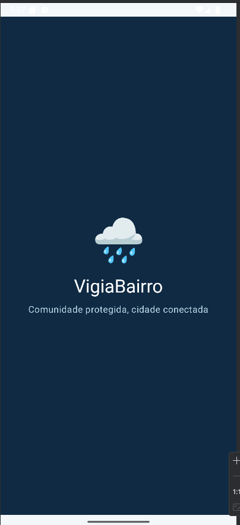
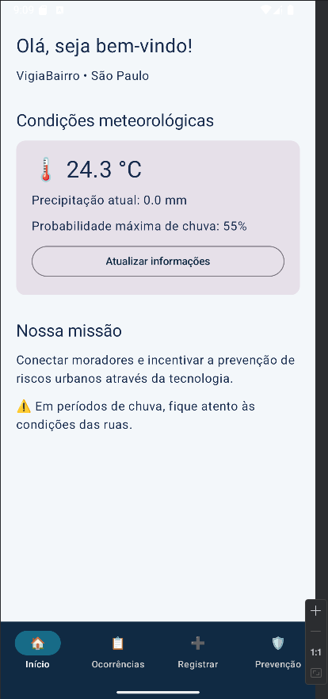
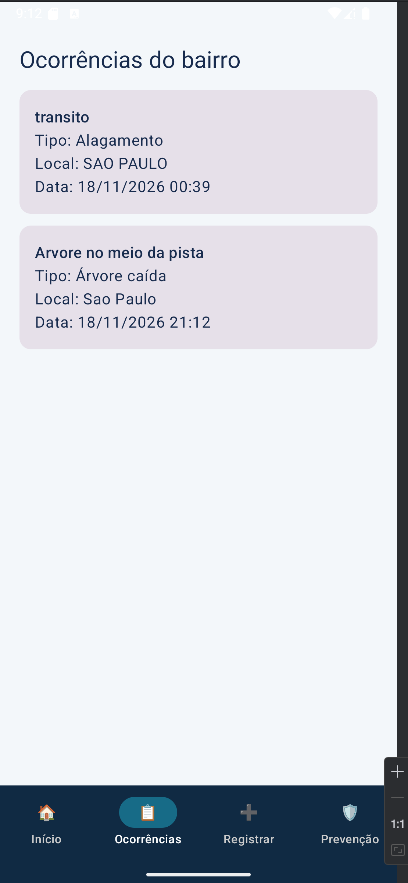
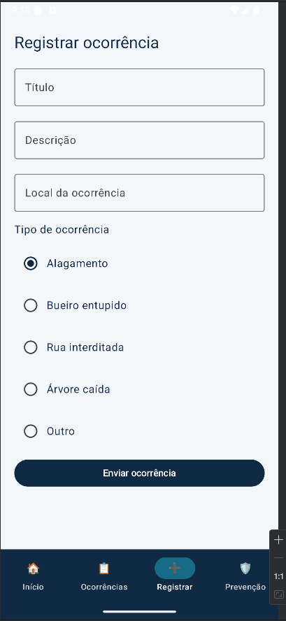
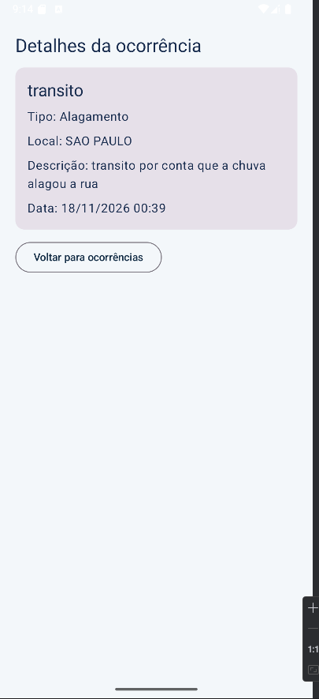
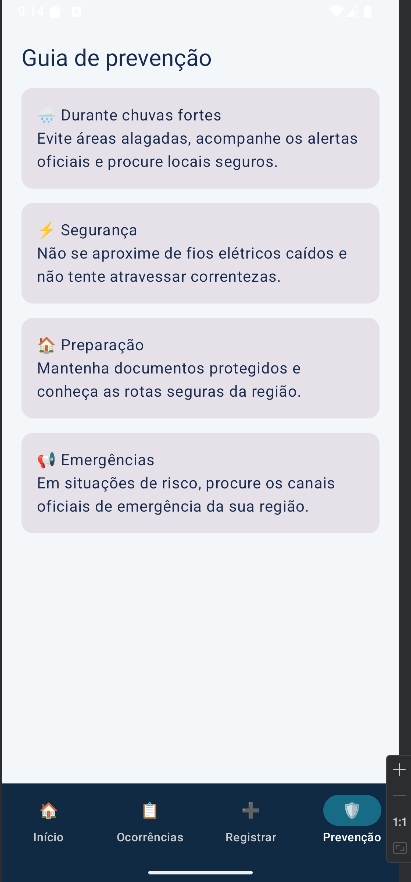

# VigiaBairro 🌧️

## Sobre a solução

O VigiaBairro é um aplicativo Android desenvolvido para incentivar a cidadania, a comunicação comunitária e a prevenção de riscos urbanos. A proposta é permitir que moradores registrem situações observadas no bairro e consultem informações meteorológicas que ajudam na prevenção.

## Problema

A falta de comunicação entre moradores dificulta a identificação e o compartilhamento de problemas urbanos, especialmente em períodos de chuva intensa.

## Objetivo

Facilitar o registro e a consulta de ocorrências locais e apresentar informações meteorológicas para apoiar a conscientização e a prevenção comunitária.

## Funcionalidades

- Splash Screen com transição automática.
- Onboarding com duas etapas e preferência para não exibir novamente.
- Tela inicial com consulta meteorológica.
- Integração REST com a API Open-Meteo usando Retrofit.
- Estados de carregamento, sucesso e erro na consulta meteorológica.
- Atualização manual das informações meteorológicas.
- Cadastro de ocorrências com validação dos campos obrigatórios.
- Listagem e visualização dos detalhes das ocorrências.
- Persistência local das ocorrências usando SharedPreferences e Gson.
- Guia com orientações básicas de prevenção.
- Navegação entre as quatro áreas principais do aplicativo.

## Tecnologias

- Kotlin
- Android Studio
- Jetpack Compose e Material 3
- Navigation Compose
- ViewModel e StateFlow
- Retrofit e Gson
- SharedPreferences

## API

**Open-Meteo:** https://open-meteo.com/

A consulta utiliza coordenadas de São Paulo (latitude -23.5505 e longitude -46.6333), retornando temperatura atual, precipitação e probabilidade máxima diária de chuva.

## Organização do projeto

O projeto separa modelos, acesso remoto, repositórios, telas, componentes visuais, tema e ViewModel. As ocorrências são armazenadas localmente no dispositivo.

## Fluxo de telas

Splash → Onboarding (na primeira utilização, conforme preferência salva) → Início.

Pela barra inferior, o usuário acessa Ocorrências, Registrar e Prevenção. Ao selecionar um registro, abre-se a tela de detalhes.

## Capturas de tela

As imagens das telas do aplicativo estão disponíveis na pasta `screenshots`.

## Integrantes

Marcos Henrique RIbeiro de Santana
RM:98561

## Instituição
Prova de DP - Android
**FIAP — Global Solution 2026.2**
